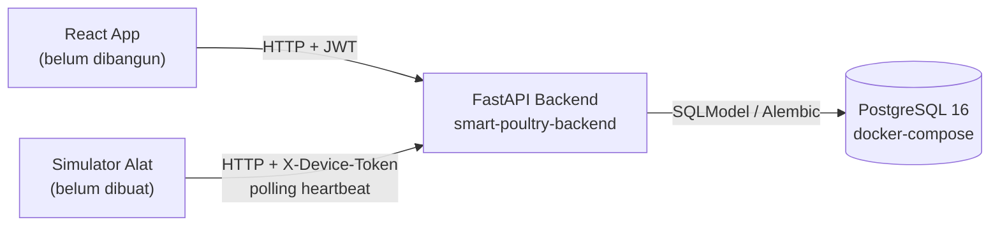
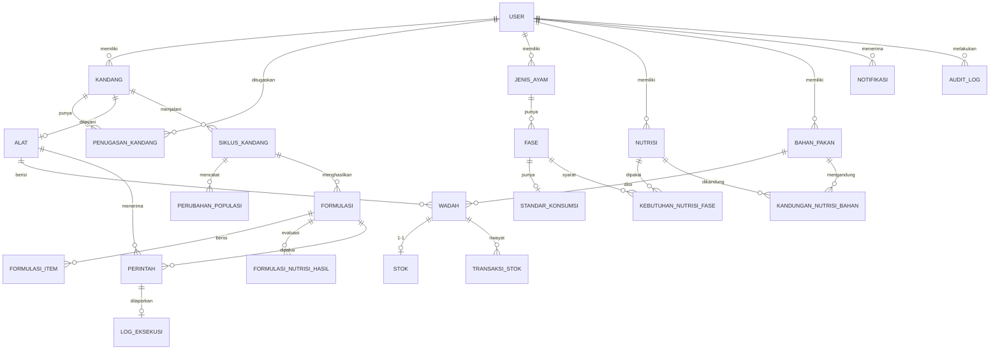
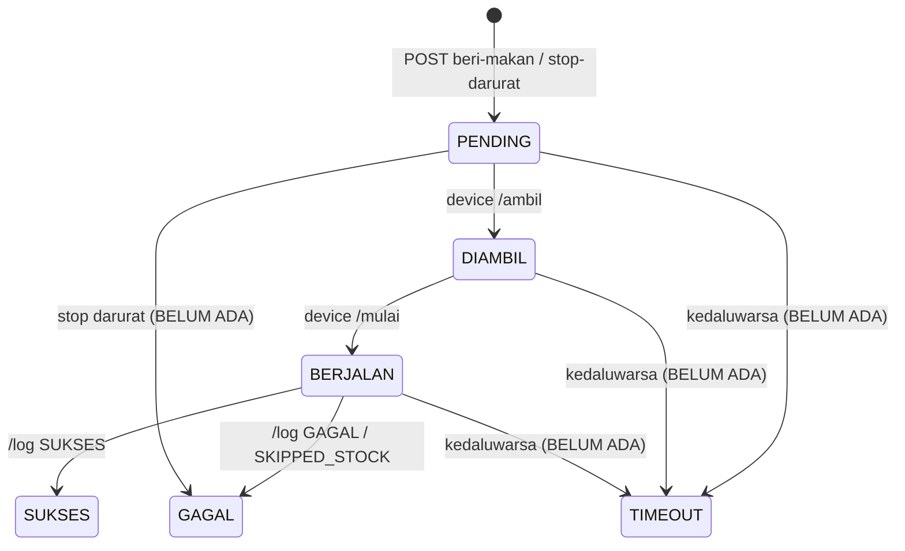

# 02 — Analisis Arsitektur & Data

## 1. Gambaran sistem

- 4 komponen terpisah, tidak saling import kode. Satu-satunya yang menyentuh DB adalah backend.
- Stack: Python ≥3.11 (venv 3.12), FastAPI, SQLModel, psycopg3, Alembic, python-jose+passlib(bcrypt), scipy (HiGHS).
- Layering kode: `routers` (HTTP, otorisasi) → `services` (LP, proses log alat, auth) → `models` (SQLModel) ; `schemas` untuk I/O.
- Dua jalur autentikasi: `get_current_user`/`get_current_pemilik` (JWT, `sub=email`) dan `get_device_by_token` (header `X-Device-Token`).

## 2. Model data (ERD)

22 tabel dalam 1 migrasi (`903f737d4420_init_schema_mvp`). Enum disimpan sebagai native PostgreSQL ENUM.

**Observasi desain data**
1. `user` tidak punya `pemilik_id` → Pekerja tak terikat ke Pemilik (T-3). Kepemilikan Pekerja hanya implisit via `penugasan_kandang`.
2. Master data bertenant lewat `pemilik_id` (bagus), tetapi referensi silang (wadah→bahan, formulasi→nutrisi) tidak divalidasi tenant di lapisan API.
3. `Stok` 1-1 dengan `Wadah` namun pembuatannya lazy (T-6).
4. Enum `StatusFormulasi` tidak punya konsep "aktif/nonaktif", sementara kode mengandalkannya (K-2). Perlu keputusan model: status siklus-hidup vs status validitas bersifat dua dimensi berbeda — idealnya dua kolom (`status` = validitas, `aktif` = boolean), atau satu enum yang diperluas.
5. `Alat.versi_jadwal_aktif`, `AuditLog`, `StatusUser.WAJIB_GANTI_SANDI`, `SKIPPED_STOCK`, `RESET_ERROR`, `TEST` — sebagian disiapkan untuk Fase 2 dan belum dipakai; aman, tetapi catat agar tak dianggap bug.
6. Satuan nutrisi bebas teks (`satuan`) — tak ada validasi konsistensi antara `nilai_per_kg` bahan dan `batas` kebutuhan.

## 3. State machine
### 3.1 Perintah

Kode saat ini tidak menegakkan urutan (boleh PENDING→BERJALAN langsung; log boleh dikirim dari status apa pun).

### 3.2 Formulasi (rekomendasi, setelah keputusan K-2)
`dibuat(preview) → tersimpan[VALID | TIDAK_SEMPURNA]` ; formulasi terbaru VALID dianggap *aktif*; pindah fase → `PERLU_DITINJAU` + notifikasi; siklus selesai → tidak lagi dapat dipakai perintah.

### 3.3 Siklus
`AKTIF → SELESAI` (satu siklus aktif per kandang, diterapkan di level aplikasi saja – belum ada unique partial index; rekomendasi menambahkannya).

## 4. Alur beri makan (as-built vs yang diharapkan)
```mermaid
sequenceDiagram
  participant UI as React
  participant API as Backend
  participant DEV as Simulator
  UI->>API: POST /siklus/{id}/formulasi/otomatis
  API-->>UI: Preview (belum disimpan)
  UI->>API: POST /formulasi (preview)
  Note over API: ⚠ K-2/T-4: crash enum & percaya klien
  UI->>API: POST /kandang/{id}/perintah/beri-makan
  Note over API: ⚠ T-5: formulasi_id & stok tak divalidasi
  loop tiap ±10 dtk
    DEV->>API: POST /device/heartbeat
    API-->>DEV: perintah_pending?
  end
  DEV->>API: /ambil → /mulai → /log
  Note over API: ⚠ K-3: crash notifikasi; T-6: stok tak berkurang
  UI->>API: GET /perintah/{id} (polling)
```

## 5. Algoritma formulasi (LP)
- Variabel: proporsi `x_i ∈ [0, batas_maksimum_i ∪ 1]` untuk bahan terpasang di wadah; objektif `min Σ harga_i·x_i`; `Σ x_i = 1`;
  per nutrisi `min ≤ Σ k_ij·x_i ≤ max`. Solver `linprog(method="highs")`.
- `berat_per_sesi_i = x_i × (gram/ekor/hari × populasi ÷ frekuensi)` → gram per sesi per bahan.
- Kelebihan: sederhana, deterministik, cepat. Batasan: tidak ada batas minimum per bahan, tidak ada kendala kapasitas wadah / stok tersedia, tidak ada diagnosis infeasible (S-1).
- Rekomendasi: tambahkan kendala stok (opsional), tampilkan nutrisi yang paling "jauh" saat infeasible, uji unit dengan kasus emas (contoh jagung+bungkil kedelai+dedak).

## 6. Keamanan (ringkas)
| Area | Status |
|---|---|
| Password hashing bcrypt | ✅ |
| JWT HS256, `sub=email`, expire 24 jam | ✅ (secret default lemah, S-16) |
| Pemisahan jalur manusia/perangkat | ✅ |
| Isolasi tenant (Pemilik) | ⚠️ T-1..T-3, T-12 |
| Token alat plaintext di DB | Diterima MVP; rencana: simpan hash |
| CORS / rate-limit / HTTPS | Belum (S-13) ; HTTPS ditangani platform deploy |
| Rahasia di repo | `.env` di-gitignore ✅; password DB dev ada di compose & `.env.example` |

## 7. Operasional & deployment
- Lokal: `docker compose up -d` (DB) + `alembic upgrade head` + `uvicorn app.main:app --reload`.
- Belum ada: Dockerfile backend, service backend di compose, CI, health check yang menguji DB, strategi backup, log terstruktur.
- Demo: platform belum diputuskan (Railway/Render/Fly). Rekomendasi: Render/Railway karena PostgreSQL managed + deploy dari Dockerfile sederhana.
