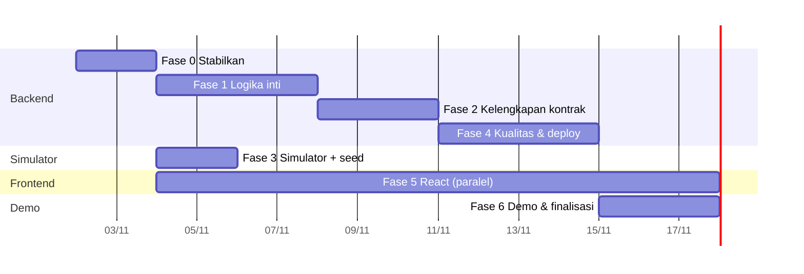

# Roadmap — Tahapan Berikutnya untuk Menyelesaikan Smart Poultry (MVP)

Dasar: temuan di [03-review-kode](../analisis/03-review-kode.md), [04-gap-analysis-api](../analisis/04-gap-analysis-api.md),
risiko di [05](../analisis/05-risiko-dan-technical-debt.md). Estimasi adalah usaha satu developer (hari kerja efektif) dan
bersifat kasar; sesuaikan dengan jumlah anggota tim. Perubahan skema/enum membutuhkan persetujuan (aturan "model final").

## Peta urutan

(Tanggal ilustratif mulai 2 Nov 2026; geser sesuai kalender tim.)

## Fase 0 — Stabilkan fondasi (±2 hari) · BLOCKER
Tujuan: alur inti tidak crash.
| Task | Rincian | Acuan |
|---|---|---|
| 0.1 Putuskan D-1 (status formulasi) | Pilih opsi A/B/C di dok 05 | K-2 |
| 0.2 Perbaiki `StatusNutrisi` | `KURANG/SESUAI/BERLEBIH` di `_evaluate_nutrisi`; "tidak sesuai" = ≠ SESUAI | K-1 |
| 0.3 Perbaiki status formulasi | Sesuai keputusan 0.1 + migrasi Alembic bila perlu (`alembic revision --autogenerate`) | K-2 |
| 0.4 Perbaiki jenis notifikasi | `PERINTAH_SUKSES/PERINTAH_GAGAL` di `services/device.py` | K-3 |
| 0.5 Konfigurasi | `echo` via setting (default False), heartbeat dari settings, CORS origin dari settings | S-9, S-12, S-13 |
| 0.6 Smoke test manual (Swagger/curl) | login → master data → kandang/alat/wadah → siklus → formulasi manual+otomatis → simpan → beri makan → (curl meniru device) → stok & notifikasi | — |
**DoD:** skenario smoke test lulus tanpa 500; hasil dicatat di dokumen uji.

**Progres:** Fase 0 **selesai** (1 Nov 2026). Smoke test Swagger (0.6) lulus semua skenario.

## Fase 1 — Kebenaran logika inti & keamanan (±4 hari)
| Task | Rincian | Acuan |
|---|---|---|
| 1.1 Tenant isolation | Validasi kandang di penugasan (buat/akhiri); putuskan D-2; scope `GET/PATCH /users`; validasi `bahan_pakan_id` wadah | T-1, T-2, T-3, T-12 |
| 1.2 Stok otomatis | Buat `Stok` bersama `Wadah`; migrasi data untuk wadah lama; `ambang_menipis` default | T-6 |
| 1.3 Validasi beri-makan | `formulasi_id` milik siklus aktif kandang & layak; cek stok cukup (D-4); alat online efektif | T-5, T-7 |
| 1.4 State machine perintah | Tabel transisi legal; lazy-timeout (D-5); STOP_DARURAT membatalkan perintah aktif | T-8, T-9 |
| 1.5 Log alat | Idempotensi per perintah, 200 vs 201, `SKIPPED_STOCK`, gunakan `berat_aktual` bila relevan | T-10 |
| 1.6 Simpan formulasi aman | Hitung ulang server-side atau verifikasi preview; validasi id | T-4 |
| 1.7 Notifikasi lengkap | Helper `notify`; kirim ke Pemilik + pekerja ditugaskan; STOK_MENIPIS/KOSONG, ALAT_OFFLINE/ERROR, PERLU_DITINJAU | T-11 |
| 1.8 Audit | Tulis `AuditLog` untuk koreksi stok, penugasan, ubah status user | S-14 |
| 1.9 Diagnosis infeasible | Daftar nutrisi bermasalah di `pesan` + `nutrisi_hasil` | S-1 |
**DoD:** setiap perbaikan punya test (lihat Fase 4) atau skenario manual terdokumentasi; checklist AGENTS (§Checklist) terpenuhi.

**Progres (1 Nov 2026, branch `fitur/fase-1-logika-inti`):** selesai — 1.1 (tenant isolation, `User.pemilik_id`), 1.2 (stok otomatis + backfill), 1.3 (validasi beri makan, stok cukup → 409), 1.4 (state machine, lazy-timeout, alat OFFLINE, stop darurat), 1.5 (idempotensi log 200/201, SKIPPED_STOCK), 1.7 (notifikasi ke Pemilik + pekerja), 1.8 (AuditLog). **1.6 (T-4) selesai.** Belum: 1.9 (diagnosis infeasible, S-1). Tambahan di luar rencana awal: DELETE aman + koreksi siklus (P1 dan P2, lihat [analisis/06](../analisis/06-analisis-endpoint-delete.md)). Test otomatis: 46 test lulus (`pytest`, DB `smart_poultry_test`).

## Fase 2 — Kelengkapan kontrak (±3 hari)

> ✅ **Selesai (2 Nov 2026):** 2.1 template, 2.2 paginasi, 2.3 `GET /kandang/{id}/alat` + nama di formulasi, 2.4 hapus aman (P1/P2), 2.5 validasi & konsistensi kode error, 2.6 kontrak diperbarui. Skenario uji manual: [smoke-test-fase-2.md](../panduan/smoke-test-fase-2.md).
| Task | Rincian |
|---|---|
| 2.1 Template jenis ayam (BR-13) | `GET /template/jenis-ayam`, `POST …/{id}/salin`; sumber JSON statis (D-6) |
| 2.2 Paginasi | Dependency `skip/limit` (default 20, maks 100) di semua list |
| 2.3 Endpoint bantu UI | `GET /kandang/{id}/alat` (alat + wadah + bahan + stok) – **minta persetujuan** karena di luar kontrak |
| 2.4 Hapus aman | Cek referensi sebelum DELETE → 409 (S-15) |
| 2.5 Validasi tambahan | `jumlah>0`, kandang aktif, konsistensi error 400 vs 409 (S-6, S-7) |
| 2.6 Pembaruan kontrak | Sinkronkan `docs/spesifikasi/API_CONTRACT.md` dengan perubahan nyata |

## Fase 3 — Simulator alat & seed demo (±2 hari, paralel setelah Fase 0)

> ✅ **Selesai (1 Nov 2026):** `simulator/run.py` (opsi `--fail-rate`, `--skip-stock-rate`, `--proses-delay`, `--offline-after`, `--once`, dst.), 9 test, dan uji nyata uvicorn + CLI. Panduan: [simulator.md](../panduan/simulator.md). Seed demo sudah ada sejak sebelumnya (`seed_demo.py`).
- Folder `simulator/` (di luar `smart-poultry-backend/`): `run.py --device-token ... --base-url ...` memakai `httpx`.
- Perilaku: heartbeat tiap `heartbeat_interval_seconds`; ambil → delay → mulai → delay → log; opsi `--fail-rate`, `--delay`, `--offline-after`; `id_eksekusi_unik=uuid4`.
- ✅ *Seed demo sudah ada (`seed_demo.py`, 1 Nov 2026).* Semula: skrip seed demo (`seed_demo.py`): Pemilik+Pekerja, jenis ayam broiler (starter/grower/finisher), nutrisi (protein, energi, kalsium, fosfor, lisin), 5–6 bahan berharga & kandungan, kebutuhan per fase, standar konsumsi.
**DoD:** demo CLI tanpa frontend: dari seed sampai stok turun dan notifikasi muncul.

## Fase 4 — Kualitas & operasional (±4 hari)
| Task | Rincian |
|---|---|
| 4.1 Test | `pytest` + DB test (SQLite tidak cukup karena ENUM/UUID → gunakan Postgres test via compose atau `testcontainers`). Prioritas: LP (feasible/infeasible/batas bahan), manual, alur perintah, otorisasi Pemilik/Pekerja/lintas-Pemilik, idempotensi log |
| 4.2 Lint & format | `ruff` + `ruff format`, `pre-commit` opsional |
| 4.3 Container | `Dockerfile` backend, service `backend` di compose (Opsi B `.env.example`), health check DB (`/health/db`) |
| 4.4 CI ringan | GitHub Actions: lint + test (hanya bila tim setuju — ARCHITECTURE menyatakan tanpa CI/CD kecuali diminta) |
| 4.5 Hardening | Secret wajib, token alat di-hash (opsional), rate-limit login (opsional), hapus kredensial default dari demo publik |

## Fase 5 — Frontend React (paralel, ±2 minggu)
Urutan halaman (nilai demo tertinggi dulu):
1. Login & layout (JWT di memori + refresh manual; interceptor 401).
2. Dashboard kandang (status alat, siklus aktif, stok ringkas, notifikasi).
3. Master data: nutrisi, bahan pakan (+kandungan), jenis ayam/fase (+kebutuhan, standar konsumsi), template salin.
4. Kandang → alat (tampilkan token sekali) → wadah↔bahan.
5. Siklus & populasi.
6. **Formulasi** (otomatis/manual → preview tabel nutrisi berwarna → simpan).
7. **Beri makan** (tombol → polling `GET /perintah/{id}` 1–2 dtk → status) + stop darurat.
8. Stok (isi ulang/koreksi), notifikasi, kelola pekerja & penugasan.
Teknis: React + Vite + TypeScript, TanStack Query, generator tipe dari OpenAPI backend (`openapi-typescript`), UI kit (mis. shadcn/ui / MUI).
**DoD:** skenario "Definisi selesai MVP" (PRD) dapat didemokan di UI.

## Fase 6 — Demo & finalisasi (±3 hari)

> Keputusan 2 Nov 2026 (D-10): tiap anggota memakai database lokal. Bagian "deploy backend + Postgres managed" di bawah baru dikerjakan bila tim membutuhkan staging online bersama (rencana awal: Supabase untuk DB + Render/Railway untuk backend; perlu Dockerfile backend).
- Deploy backend + Postgres managed (D-7), `alembic upgrade head`, seed demo, CORS untuk domain frontend.
- Skrip & checklist demo (akun, data seed, urutan klik, rencana cadangan: rekaman layar, simulator lokal).
- Latihan demo ≥2 kali; bekukan fitur 2 hari sebelum presentasi.
- Dokumen akhir: perbarui `docs/` (kontrak, arsitektur, panduan), catatan Fase 2 (jadwal, role dinamis, offline-resilience).

## Rekomendasi eksekusi segera (minggu ini)
1. Rapat 15 menit untuk menjawab D-1, D-2, D-3 (dok 05).
2. Kerjakan Fase 0 hari ini → buktikan alur inti hidup.
3. Mulai simulator (Fase 3) dan kerangka frontend (login + kandang) secara paralel.
4. Fase 1 sambil menulis test pertama untuk setiap perbaikan.

## Di luar MVP (Fase 2 produk — jangan dikerjakan sekarang)
Penjadwalan & sesi jadwal, pengajuan/persetujuan jadwal, role/permission dinamis, Super Admin, buffer offline alat,
sensor stok fisik, notifikasi email/WhatsApp.
